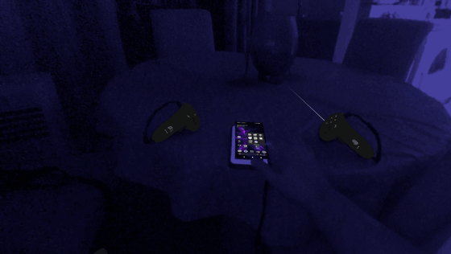

# Phone Screen

Use your real Android phone inside VR on the **Steam Frame**. The headset tracks the phone you're holding, and its screen is drawn in VR exactly on top of it. Your apps, your touches and your phone's sound all work, with no PC needed: everything runs on the headset.

<!-- Demo video: put a GIF or a link to a video here, for example
[](https://youtu.be/VIDEO_ID)
-->
*Demo video coming soon.*

Phone Screen is an independent hobby project. It is not made by, or affiliated with, Valve or Google. It is experimental and works, but it isn't finished. Ideas and pull requests are very welcome. That's why it's here.

## How it works

The phone app shows a **tracking pattern** (two ArUco markers) on the real screen. Your apps run on a hidden **virtual display** (through [scrcpy](https://github.com/Genymobile/scrcpy)'s server), and that hidden screen is what you see in VR. Touches on the real screen go to it.

Several things work together to place the phone:

| Source | What it gives |
|---|---|
| Headset tracking cameras ([Frametop](https://github.com/DeeJanuz/frametop)'s `ft-camd`) | Marker corners. Every corner from every camera goes into one fit, each camera with the head pose at its own moment. |
| Phone motion sensors (game rotation vector, linear acceleration, about 200 Hz) | How the phone is turned, and its motion between camera sightings (Kalman filter). |
| Lit screen outline | Position when the markers are too small to read, with the turn taken from the sensors. |
| Phone selfie camera + face detector (YuNet) | The direction to your nose: tracking from the other side (still learning, see below). |

The phone and the headset match clocks over a ping/pong exchange, so every reading is placed at its true moment. The headset pose is sampled at 200 Hz and interpolated to each camera picture's time.

### It teaches itself

Most of the tuning is learned while you use it, and saved in `~/.config/phone-screen/learned.json`:

- **Each camera's delay.** When the phone's own sensors say it is lying still, the cameras must see it in one place however your head moves. If it seems to move with your head, the delay that keeps it still is learned.
- **How far ahead to draw.** The drawn screen is compared with where the cameras later saw the phone, until it no longer trails behind.
- **Where your face is.** The selfie camera's rays to your nose, taken from many places, meet at the nose. That also settles how big your face looks at each distance, and whether the camera picture is mirrored.
- **Smaller things:** heading, sighting noise, pattern brightness, and how much the screen's glow widens its outline in each camera.
- **Training mode (optional).** A see-through copy of the pattern hangs still in VR. Line the real phone up with it and tap the screen. Each tap is a sample, and their average becomes a fixed correction.

## What you need

- A Steam Frame running SteamOS with SteamVR.
- [Frametop](https://github.com/DeeJanuz/frametop)'s camera broker `ft-camd` (in `hands/`). **Also apply `frametop-camd-exact-buffers.patch`** (see below).
- A `dev` distrobox with `adb` (`android-tools`) and Java (JDK 17 or newer), to build the phone app.
- An Android phone (Android 13 or newer) with wireless debugging paired to the headset. Developed on a Pixel 9 Pro XL (Android 16), but other phones should work: the app measures your phone itself (see [Other phones](#other-phones)).
- Optional: `clip-tts` on the PATH, for spoken status messages.

## Setup

On the Steam Frame, in this folder:

1. **Python side:** `./setup.sh` (Python venv, scrcpy server, face model).
2. **Phone app:** either download `PhoneScreen-vN.apk` from the [Releases](https://github.com/MrDarkMoon/phone-screen/releases) page, or build it yourself:
   ```sh
   android/sdk-setup.sh                       # Android build tools (aapt2/zipalign through FEX on the ARM Frame)
   distrobox enter dev -- android/build.sh    # builds android/build/PhoneScreen.apk
   ```
   A self-built app is signed with your own key, so it can't install over a release one (uninstall that first).
3. **Wireless debugging:** on the phone, turn on Developer options, then Wireless debugging. Pair once from the Frame: `distrobox enter dev -- adb pair IP:PORT` (the phone shows both and a code). Check with `distrobox enter dev -- adb devices`. With more than one device connected, set `PHONE_SERIAL`.
4. **Install the app:** `distrobox enter dev -- adb install PhoneScreen.apk`, or copy the APK to the phone and open it there.
5. **Background service:** `./install.sh`. It starts tracking whenever the phone app does.

### Other phones

You don't need to change any code for a different phone. When you press Start tracking, the app sends the Frame:

- the screen's size in pixels and its true pixel density (so its size in millimetres),
- where the selfie camera is (from the screen's punch hole or notch),
- the size and place of the markers it draws (as big as your screen's width allows, 56 mm at most).

The Frame saves these in `~/.config/phone-screen/phone.json` and writes them to the log (`~/.local/state/phone-screen/phone-screen.log`, a line starting `phone app tracking:`). Check that line: the millimetres should match your phone's real screen. If the phone reports a nonsense density, the Pixel's size is used and the log says so. If there's no punch hole, the camera is guessed to be 7 mm below the top edge in the middle.

Things that may differ on other phones:

- **Brightness:** the cameras need the screen fairly bright. The brightness is learned, but very dim or very glossy screens may track worse.
- **Gestures:** the app keeps the screen's side edges for the VR screen's back swipe. Some phones' own gestures may still win.
- **Learned values** in `~/.config/phone-screen/learned.json` belong to one phone. After changing phones, delete that file (with the tracker stopped) so it learns afresh.

## Use

Open **Phone Screen** on the phone and press **Start tracking**. The service starts the camera feed and the tracker, and your phone's screen appears in VR on the phone. To stop, hold three fingers on the screen for 2 seconds. About 15 seconds later everything is switched off and the headset is back to normal.

To run it by hand instead: `venv/bin/python -u phone_screen.py` (add `PHONE_REC=1` to record `~/.local/state/phone-screen/track.csv` for analysis).

## Working on the tracking without a Frame

`replay.py` replays a recorded `track.csv` through the position filter (`fusion.py`), with no headset or phone needed:

```sh
venv/bin/python replay.py track.csv                       # how well the recorded run went
venv/bin/python replay.py track.csv --set ACCEL_NOISE=2   # the same, with one of fusion.py's numbers changed
```

It prints the **drawn error** (where the screen was drawn, against where two or more cameras later saw the phone at that moment), **jitter**, **surprise** (how far each sighting was from the filter's guess), and **replay match** (how close the replay is to the live run; about 0 with `fusion.py` unchanged). Change `fusion.py` and run it again to see if your idea helps. Recordings are made on the Frame with `PHONE_REC=1`; share one in an issue if you'd like others to try.

## Making a release

`./release.sh N` builds app version N into `dist/PhoneScreen-vN.apk` (with a sha256 file). `./release.sh N --publish` puts it on a GitHub Release (it asks first, and the commit must be pushed). Keep `~/.config/phone-screen/app-key.jks` safe: every release must be signed with the same key to install over the last one.

## The camera timing fix for ft-camd

`ft-camd` borrows the headset's camera buffers from XRService. After XRService restarts streaming, the buffer order is shuffled, and `ft-camd` had to guess which buffer held each new frame. For the two side (SLAM) cameras it often picked an older one, so frames were 0 to 250 ms older than their timestamps, at random. Anything tracked then jumped whenever the head moved.

The patch asks V4L2 (`VIDIOC_QUERYBUF`) which buffer each index holds, for every frame, so nothing is guessed. Static-phone tests went from 20 to 40 mm of wander during head movement to 4 to 5 mm. After rebuilding, `ft-camd` needs its capabilities again (`hands/run.sh caps`, or `sudo setcap cap_dac_read_search,cap_sys_ptrace,cap_perfmon=ep hands/build/ft-camd`).

## Files

| File | Job |
|---|---|
| `daemon.py`, `install.sh` | background service |
| `phone_screen.py` | main loop: overlay, fusion, everything together |
| `markers.py`, `solve.py` | marker and outline finding, joint fits |
| `pattern.py` | the phone: its screen, selfie camera and marker layout, as its app reports them |
| `fusion.py`, `sensors.py`, `headhist.py` | Kalman filter, phone sensors, head-pose history |
| `replay.py` | replays a recorded track through the filter offline |
| `release.sh` | builds the phone app for a GitHub Release |
| `learn.py`, `train.py`, `facetrack.py` | self-learning, training mode, selfie-camera face tracking |
| `phonelink.py`, `android/` | the phone app and its link (adb reverse, port 8778) |
| `video.py`, `sharedtex.py`, `home.py` | scrcpy virtual display, sound, DMA-BUF overlay texture, VR home screen |

## Known problems and ideas

- Face tracking is learning, but its rays still scatter by about 3 cm. Better lens values, its own timing, and more face points should help.
- The marker pattern needs the screen fairly bright, and markers get hard to read beyond about 70 cm.
- The VR home screen is a static copy of the real one (`homecap.py`), because Android only runs the real launcher on the main display.
- The face detector costs a fair amount of CPU.
- Ideas: a printed marker on the headset for the selfie camera to track (`print/make_head_marker.py`), or the headset's IR illuminators.

## Credits

[scrcpy](https://github.com/Genymobile/scrcpy) (Apache 2.0) for the phone's screen, input and sound. [Frametop](https://github.com/DeeJanuz/frametop) (MIT) for the camera broker and calibration. [OpenCV](https://opencv.org) and its [YuNet](https://github.com/opencv/opencv_zoo) face model. [PyAV](https://github.com/PyAV-Org/PyAV) and [pyopenvr](https://github.com/cmbruns/pyopenvr).

## License

MIT
